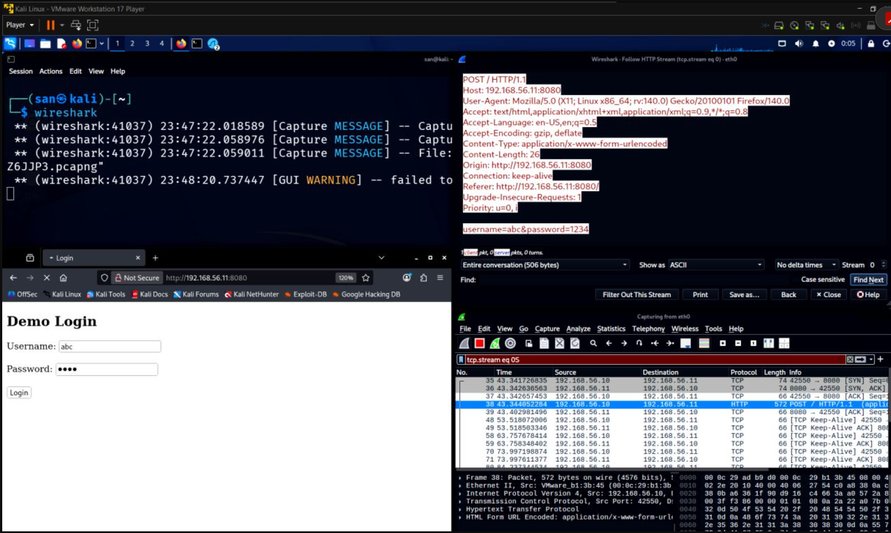

# HTTP Traffic Investigation & Credential Visibility Analysis

**Activity type:** Home SOC lab / network traffic analysis  
**Author:** Sanket Shetty  
**Original LinkedIn post:** https://www.linkedin.com/posts/sanket-shetty-467008329_cybersecurity-socanalyst-wireshark-share-7462391397011345408-pdP5/

## 1. Objective

Examine how HTTP communication appears at packet level and understand what information may be exposed when a client submits data over unencrypted HTTP.

## 2. Lab environment

The original activity described this setup:

- **Client:** Kali Linux
- **Server:** Windows 11 virtual machine
- **HTTP server:** Python's built-in HTTP server
- **Traffic analysis:** Wireshark

The retained screenshot shows the page being accessed at `http://192.168.56.11:8080`.

## 3. Methodology and evidence

The retained screenshot shows Wireshark's **Follow HTTP Stream** view and a selected HTTP POST request. The following details are visible:

| Field | Visible value |
|---|---|
| HTTP method/version | `POST / HTTP/1.1` |
| Host header | `192.168.56.11:8080` |
| Destination IP/port | `192.168.56.11:8080` |
| Content type | `application/x-www-form-urlencoded` |
| Content-Length header | `26` |
| User-Agent | Firefox on Linux, as displayed |

The reconstructed request body contains username and password form fields. The displayed values `abc` and `1234` were confirmed by the author as dummy credentials created for this lab; they are not real account credentials.

### Retained screenshot

Figure 1 — Browser test page and reconstructed HTTP POST stream. The displayed form values are synthetic demonstration credentials.

The screenshot supports the displayed POST request and test page. It does not document every request or response in the exercise.

## 4. Observations

- A POST request was visible in the reconstructed HTTP stream.
- The request headers and form body were readable in Wireshark.
- The request used `application/x-www-form-urlencoded`.
- The displayed form fields were transmitted over HTTP, not HTTPS.
- The screenshot does not establish the complete sequence of GET requests, all server responses, or HTTP response codes.

## 5. Defensive interpretation

HTTP does not encrypt application-layer content. A party able to capture traffic on the relevant network path may be able to inspect request headers and submitted form data. This creates a risk of credential disclosure and interception.

Production authentication pages and sensitive application traffic should use HTTPS/TLS with correctly configured certificates. Network defenders can investigate unexpected cleartext HTTP use, especially where authentication or other sensitive data is involved.

## 6. Evidence and limitations

| Evidence item | Status |
|---|---|
| Browser test page and Follow HTTP Stream screenshot | Retained in this repository |
| Original PCAP/PCAPNG | Not retained |
| Complete HTTP session | Cannot be independently reconstructed from the screenshot |
| Exact response codes and all requests | Not established by retained evidence |
| Exact server/client commands | Not visible in retained evidence |

The screenshot is visual evidence of the displayed POST request, not a substitute for the original packet capture. Packet numbers, additional requests, and response details are intentionally not asserted.

## 7. Key learning

Packet analysis can reveal information that may not be obvious from the browser interface. Understanding HTTP methods, headers, content types, and stream reconstruction helps an analyst explain why unencrypted protocols create exposure and what evidence supports that assessment.

## 8. Original activity

See the [LinkedIn activity](https://www.linkedin.com/posts/sanket-shetty-467008329_cybersecurity-socanalyst-wireshark-share-7462391397011345408-pdP5/).

## 9. Suggested interview discussion

1. What is the difference between an HTTP GET and POST request?
2. Why can the request body and headers be read in a plaintext HTTP capture?
3. What does Wireshark's Follow HTTP Stream feature show?
4. What changes when the same application is accessed over HTTPS?
5. What evidence demonstrates that the displayed form data was transmitted without encryption?
