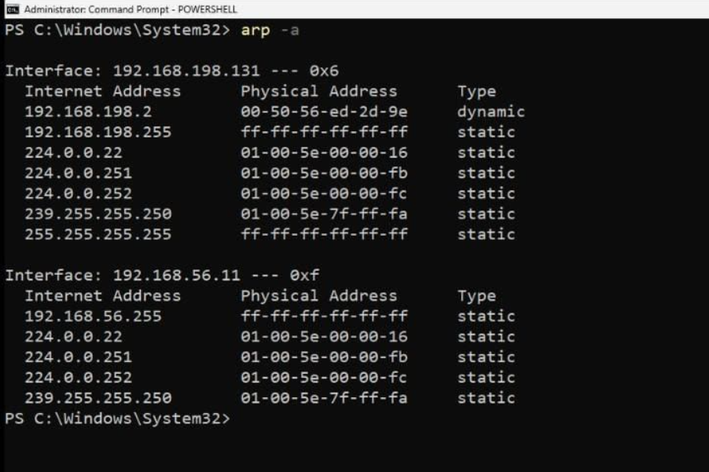
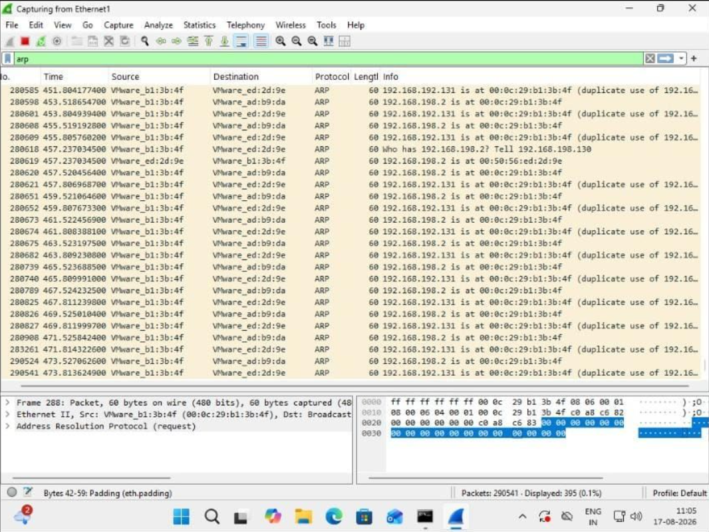
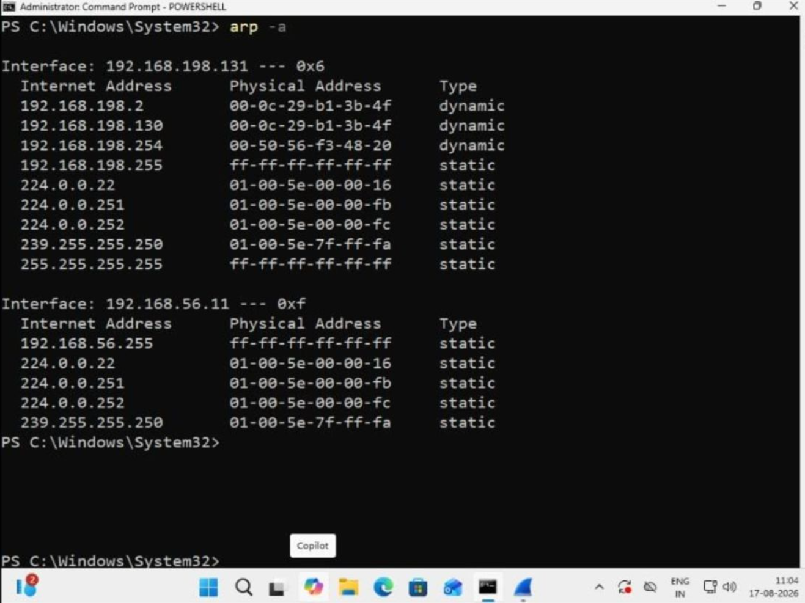
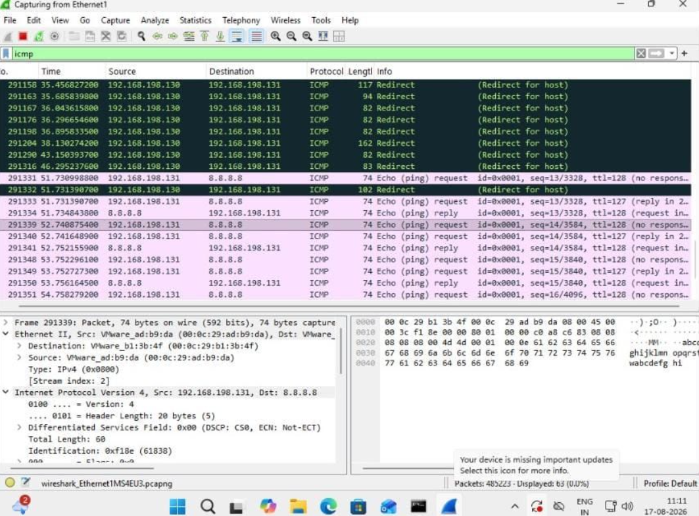
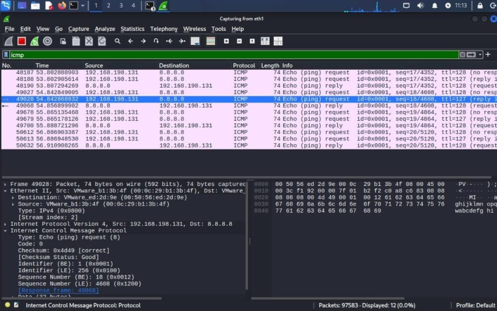

# ARP Cache Poisoning Investigation in an Isolated VMware Lab

**Activity type:** Controlled home SOC lab / network traffic investigation  
**Author:** Sanket Shetty  
**Lab environment:** Isolated VMware environment  
**Original activity:** LinkedIn post shared by the author at https://lnkd.in/p/dn8J2eMF

## 1. Objective

Compare a normal ARP-cache baseline with the cache observed after an ARP-spoofing simulation, then inspect related ARP and ICMP traffic. The defensive focus is to identify unexpected IP-to-MAC mapping changes and assess what the available evidence does—and does not—establish.

## 2. Lab environment

The retained screenshots show the following addresses:

- **Windows endpoint:** `192.168.198.131`
- **Kali system (reported in the activity):** `192.168.198.130`
- **VMware gateway:** `192.168.198.2`
- **Packet analysis:** Wireshark
- **Endpoint inspection:** Windows `arp -a`

The addresses are private lab addresses and should be interpreted only in the context of the described VMware environment.

## 3. Methodology and observations

The Windows screenshots show the output of:

```powershell
arp -a
```

### ARP cache before the simulation



<sub>Figure 1 — Baseline ARP cache showing the gateway mapping before the reported simulation.</sub>

### ARP traffic



<sub>Figure 2 — Captured ARP traffic, including repeated replies and duplicate-use indications visible in the screenshot.</sub>

### ARP cache after the simulation



<sub>Figure 3 — ARP cache after the reported simulation.</sub>

The before-and-after screenshots show:

| ARP-cache observation | Before | After |
|---|---|---|
| Gateway IP | `192.168.198.2` | `192.168.198.2` |
| MAC associated with gateway | `00-50-56-ED-2D-9E` | `00-0C-29-B1-3B-4F` |
| `192.168.198.130` | Not shown in the displayed baseline | `00-0C-29-B1-3B-4F` |

The key visible change is that the gateway IP is associated with the same MAC address shown for `192.168.198.130` in the after-state ARP table. This is consistent with ARP cache poisoning if `192.168.198.130` is the Kali test system, as described in the activity.

### ICMP Redirect traffic



<sub>Figure 4 — ICMP Redirect traffic shown in the supplied Wireshark capture.</sub>

The screenshot shows ICMP Redirect messages from `192.168.198.130` to `192.168.198.131`.

### ICMP Echo traffic



<sub>Figure 5 — ICMP echo request/reply traffic involving 192.168.198.131 and 8.8.8.8.</sub>

The screenshot shows ICMP echo requests and replies involving `192.168.198.131` and `8.8.8.8`.

## 4. Technical interpretation

ARP resolves an IPv4 address to a Layer-2 MAC address on a local network. Traditional ARP does not authenticate replies, so a host may update its ARP cache after receiving an unexpected or forged ARP reply.

Here, the gateway IP remains `192.168.198.2`, while the MAC address associated with it changes from `00:50:56:ED:2D:9E` to `00:0C:29:B1:3B:4F`. The after-state table also associates `192.168.198.130` with that same MAC address. This is suspicious and consistent with the reported ARP-spoofing simulation.

If a system receiving redirected traffic also forwards it, it may occupy a Man-in-the-Middle (MITM) position. However, the screenshots alone do not prove that all traffic was intercepted, forwarded successfully, or intercepted bidirectionally. The ICMP Redirect and echo traffic are supporting context, not conclusive proof of a complete MITM session.

## 5. Defender's perspective

A SOC or network analyst investigating possible ARP spoofing can look for:

- Unexpected changes to the MAC address associated with a trusted IP, especially the default gateway.
- Unsolicited or unusually frequent ARP replies.
- One MAC address claiming multiple IP addresses in a way that conflicts with the network baseline.
- Duplicate-IP or conflicting ARP indications.
- Endpoint traffic whose Ethernet destination unexpectedly points to an unfamiliar host.
- Corroborating switch, endpoint, DHCP, network-access-control, or network-monitoring logs, where available.

An individual ARP reply or changed mapping is not, by itself, conclusive proof of malicious activity. Compare observations with the known network topology, authorised changes, and additional evidence.

## 6. Evidence and limitations

| Evidence item | Status |
|---|---|
| Windows ARP cache before simulation | Screenshot retained |
| Wireshark ARP traffic | Screenshot retained |
| Windows ARP cache after simulation | Screenshot retained |
| ICMP Redirect traffic | Screenshot retained |
| ICMP echo traffic | Screenshot retained |
| Original PCAP/PCAPNG | Not retained |
| Complete packet sequence and packet numbers | Not available for independent review |
| Complete, bidirectional MITM forwarding | Not established by screenshots alone |

The screenshots support a changed gateway IP-to-MAC mapping and show related ARP/ICMP traffic. They do not independently prove a complete MITM session. No packet numbers, exact attack commands, or unshown forwarding behaviour are invented here.

Before publishing screenshots, review them for unrelated network details and confirm that all displayed addresses and MAC addresses are appropriate to disclose in a public portfolio.

## 7. Key learning

The important defensive lesson is that suspicious network redirection may appear as an unexpected change in a trusted IP-to-MAC relationship. Comparing current ARP observations with a known baseline can help identify possible ARP cache poisoning. Packet captures and independent network evidence are needed to determine whether the change resulted in successful traffic interception.

## 8. Original activity

The activity description was supplied by the author and was originally shared on LinkedIn: https://lnkd.in/p/dn8J2eMF

## 9. Suggested interview discussion

1. What problem does ARP solve on an IPv4 local network?
2. Why can forged ARP replies change a host's ARP cache?
3. During this exercise, why did the gateway IP remain the same while the associated MAC address changed?
4. What evidence supports a suspicious gateway mapping change?
5. Why do the screenshots not independently prove a complete, bidirectional MITM session?
6. Which network controls or monitoring signals can help detect or reduce ARP spoofing?
7. Why should an analyst compare observations against a known network baseline before classifying an event as malicious?
